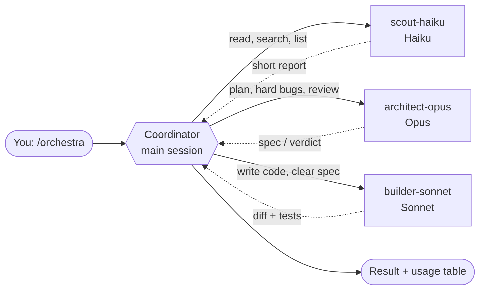

<div align="center">

# 🎼 Orchestra

### Stop making one model do everything.
**One command turns Claude Code into a conductor: Haiku scouts, Sonnet builds, Opus decides.**


</div>

---

## The problem

You ask Claude to *"find every place we compute VAT and change it"*. It starts reading. And reading. Two hundred files later, the conversation is full of code you no longer need, and the most capable (and most expensive) model has just spent its time on grunt work.

## The idea

A site manager doesn't push the wheelbarrow. **Orchestra** makes the main session *coordinate* and hand each job to the subagent whose model fits it, in a fresh context window, so only a short report comes back.

```
/orchestra find every place VAT is computed and update it to the new rate
```



| Agent | Model | Does | Tools |
|---|---|---|---|
| 🔍 `scout-haiku` | Haiku | Searches, inventories, summaries across many files | Read, Grep, Glob, Bash |
| 🔨 `builder-sonnet` | Sonnet | Writes and edits code from a clear spec | all |
| 🧠 `architect-opus` | Opus | Plans, obscure bugs, final review | Read, Grep, Glob, Bash |

**Typical flow:** Haiku explores → Opus plans *(only if needed)* → Sonnet implements → Opus reviews *(only if risky)*.

## Why it's pleasant to use

- **Manual only.** It never starts on its own: no surprise subagents. Say `stop orchestra` to go back to normal.
- **Smart threshold.** Small job? Claude just does it. Delegation is for big or parallel work.
- **Real briefs.** Every delegation states goal, files, constraints and what "done" means.
- **No blind trust.** The coordinator checks diffs and tests itself; an agent's report is not proof.
- **No two writers on the same files.** Independent tasks run in parallel, safely.
- **A usage table at the end:** agent, model, task, tokens, calls, duration. Missing figure? It says `n/a`, never an invented estimate.

## Install

**As a plugin** (skill + agents together):

```
/plugin marketplace add VjAlbert/orchestra
/plugin install orchestra@orchestra
```

**Manually:** copy `skills/orchestra/` to `~/.claude/skills/` and the files in `agents/` to `~/.claude/agents/`.

> The skill needs the three agents. Without them it cannot delegate.

Then, in Claude Code:

```
/orchestra <your job>
```

## Honest expectations

- Subagent requests **count toward the same usage limits** as the main conversation. Orchestra moves work where it costs less and keeps the context tidy; it is **not free**.
- No benchmarks, so no "saves X%" claim here.
- Not worth it for tiny edits: each subagent starts from zero and needs a full brief.
- `scout-haiku` has `Bash`: cheap and read-oriented, not strictly read-only.
- The usage table relies on `subagent_tokens` / `tool_uses` in completion notices; if your version doesn't provide them you'll see `n/a`.

## Make it yours

Everything is plain text. Edit the routing table in [`skills/orchestra/SKILL.md`](skills/orchestra/SKILL.md), swap models in the agent files (`haiku`, `sonnet`, `opus`), or add your own specialists.

## 🇮🇹 In italiano

`/orchestra <lavoro>` attiva la modalità multi-agente: la sessione principale **coordina** e delega a `scout-haiku` (Haiku, lettura e ricerche), `builder-sonnet` (Sonnet, codice con specifica chiara) e `architect-opus` (Opus, piani e revisioni). Parte solo quando la invochi. Installa skill **e** agenti insieme (plugin, oppure copia manuale in `~/.claude/skills` e `~/.claude/agents`). I subagenti consumano gli stessi limiti d'uso della conversazione: la skill ordina il lavoro, non lo rende gratis.

## License

[MIT](LICENSE) © VjAlbert
